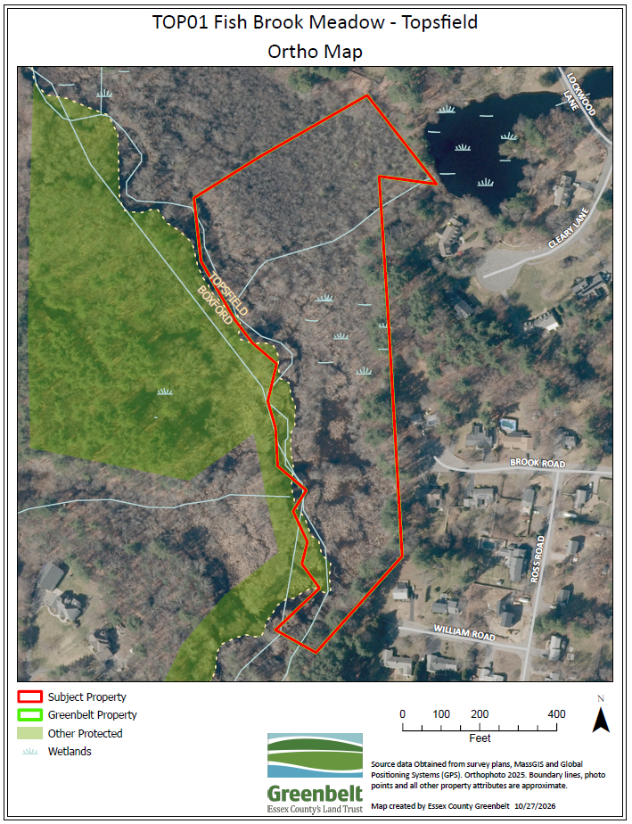
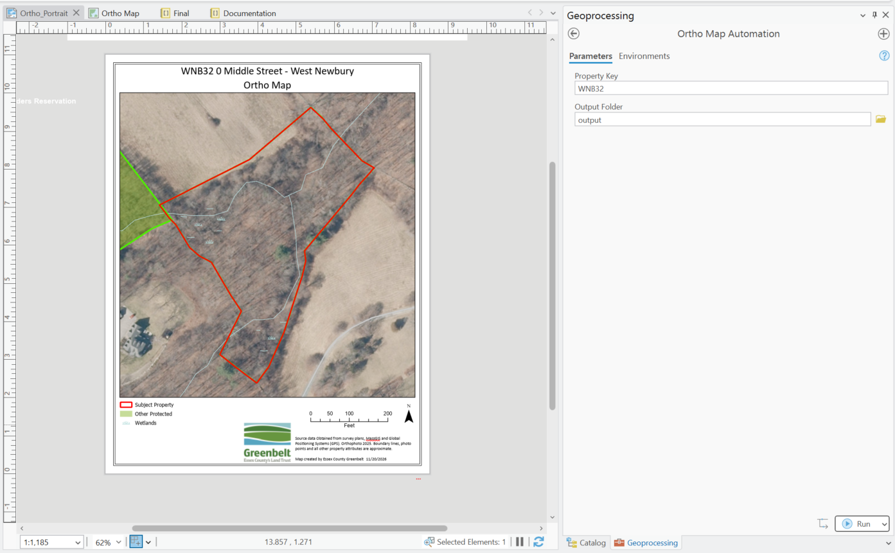
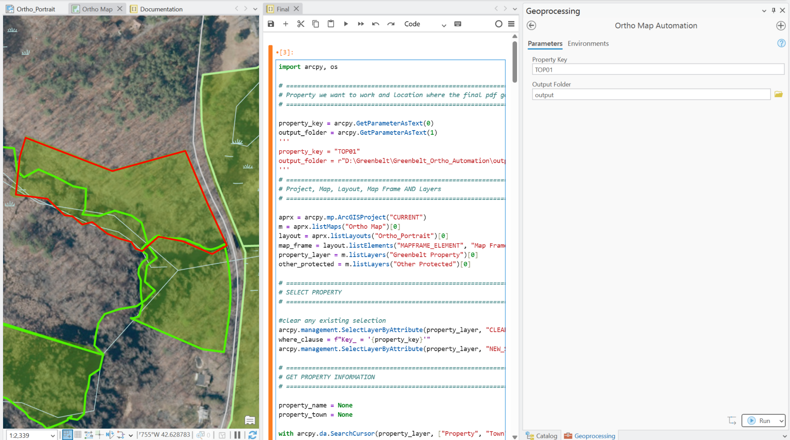

# Automated Conservation Property Map Updates Using ArcPy

### A GIS Automation Project for Essex County Greenbelt Association

## Project Overview
- This project develops a Python-based geoprocessing workflow using ArcPy and ArcGIS Pro to automate the updating of conservation property maps with 2025 orthophotography.
- The automation streamlines repetitive cartographic tasks, including property selection, map extent adjustments, boundary highlighting, layout updates, scale bar selection, and PDF export.
- The workflow was developed to support the efficient updating of more than 500 conservation property maps maintained by Essex County Greenbelt Association.

## Project Objectives
- Reduce repetitive manual map production tasks.
- Standardize cartographic layouts across conservation properties.
- Incorporate updated orthophotography into property maps.
- Automate property-specific map elements and PDF exports.
- Improve efficiency and consistency in conservation mapping.

## Technologies Used
- ArcGIS Pro — GIS analysis and map production
- Python — Automation programming
- ArcPy — Geoprocessing and cartographic automation
- Jupyter Notebook — Development and documentation
- File Geodatabase — Spatial data management

## Automation Workflow
- Property Selection: Identify conservation properties using a unique property key.
- Map Extent: Automatically zoom to the selected property and adjust the map scale.
- Boundary Highlighting: Create a red boundary to identify the subject property.
- Map Layout: Update the property name and town in the map title.
- Protected Lands: Adjust the display of overlapping protected-property features.
- Scale Bar: Select an appropriate scale bar based on the map scale and available layout space.
- PDF Export: Export the updated property map as a high-resolution PDF.

## Automation Results

### 1. Automated Conservation Property Map
The final conservation property map generated by the ArcPy automation workflow, showing the selected property boundary, updated orthophotography, map title, and scale bar.



### 2. ArcGIS Pro Geoprocessing Tool
The custom geoprocessing tool allows users to select a conservation property and specify an output folder for the exported map.



### 3. Automation Execution
The automation executes the mapping workflow and exports the completed map as a PDF.



## Project Structure
```text
greenbelt-ortho-map-automation/
├── README.md
├── .gitignore
├── src/
│   ├── Final.py
│   └── README.md
└── notebooks/
    ├── Documentation.ipynb
    └── README.md
```

## Software Requirements
- ArcGIS Pro with ArcPy
- An ArcGIS Pro project containing the required conservation property layers
- A configured map layout with the expected map frame, text elements, and scale bars
- The script is intended to run within ArcGIS Pro and requires the appropriate project configuration and data.

## Project Outcomes
The automation provides a repeatable workflow for updating conservation property maps, reducing the need to manually adjust individual map layouts.
The project demonstrates practical applications of Python programming, GIS automation, spatial data processing, and cartographic design in conservation management.

## Author
Shivaraj Thapa |
M.S. Geo-Information Science | Salem State University |
GIS Intern | Essex County Greenbelt Association

## Acknowledgment
Developed as part of GIS internship work with Essex County Greenbelt Association.
